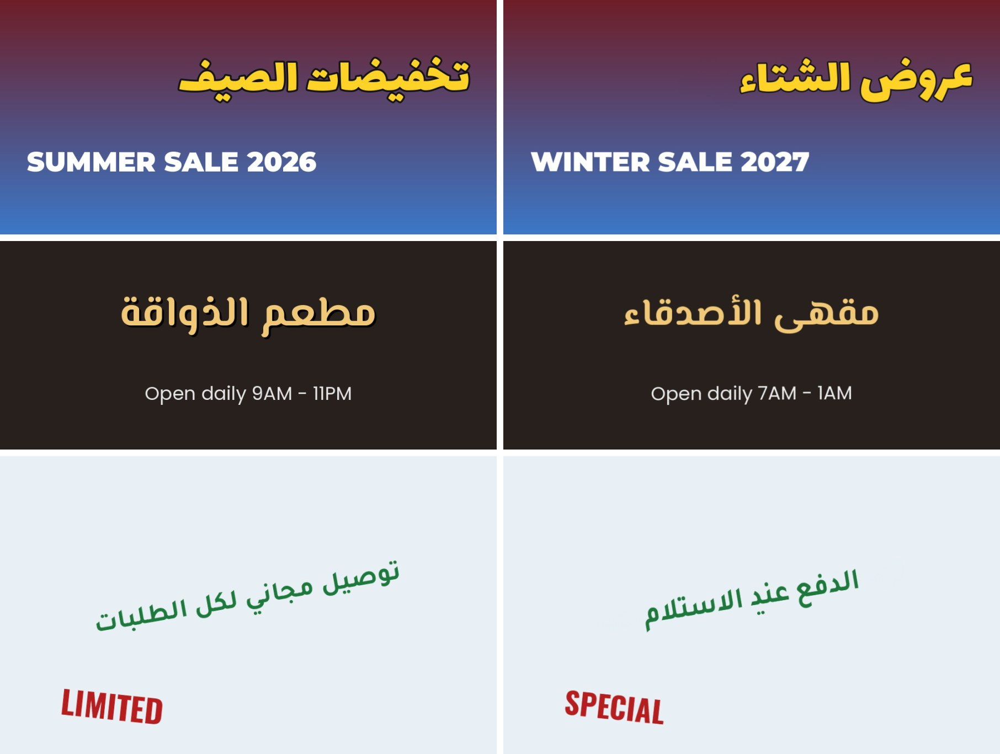

# استوديو النصوص — استبدال النصوص داخل الصور

منصة ويب وظيفتها واحدة: **تكتشف كل النصوص في الصورة، وعند استبدال أي نص يظهر النص الجديد في نفس الموضع والمساحة، وبنفس الخط والحجم واللون والحدود والظل والدوران**، بعد مسح النص الأصلي وإعادة بناء الخلفية خلفه.



> يمين: بعد الاستبدال · يسار: الأصل. لاحظ أن الحدود السوداء، واتجاه الدوران، ونوع الخط (Lalezar / Montserrat / Poppins / Tajawal / Oswald) كلها مُستخرجة تلقائيًا.


---

## التشغيل

### بأمر واحد (Docker)

```bash
cd image-text-studio
docker compose up --build
```

- الواجهة: <http://localhost:3000>
- الـ API وتوثيقه التفاعلي (OpenAPI): <http://localhost:8000/docs>

### للتطوير (بدون Docker)

المتطلبات: Python 3.12+، Node 22+، وعلى Ubuntu/Debian:

```bash
sudo apt-get install -y tesseract-ocr tesseract-ocr-ara tesseract-ocr-eng libraqm0 libfribidi0 fonts-hosny-amiri fonts-noto-core fonts-kacst fonts-dejavu-core
```

الخادم:

```bash
cd image-text-studio/backend
pip install -r requirements-dev.txt
python scripts/build_fonts.py        # يبني مكتبة الخطوط (57 خطًا) من حزم @fontsource على npm
uvicorn app.main:app --reload --port 8000
```

الواجهة (في نافذة أخرى):

```bash
cd image-text-studio/frontend
npm install
npm run dev                          # http://localhost:3000 — يمرر /api إلى http://127.0.0.1:8000
```

### الاختبارات وقياس الجودة

```bash
cd image-text-studio/backend
python -m pytest -q tests            # 21 اختبارًا: جودة الـ pipeline + الـ API من البداية للنهاية
python scripts/benchmark.py --save out/   # جدول دقة مفصل لكل نص + صور قبل/مسح/بعد
```

---

## كيف تعمل (الـ Pipeline)

```
رفع الصورة
  └─ 1. الاكتشاف  ── DBNet (PP-OCRv3, ONNX) → رباعيات (polygons) + دمج كلمات السطر الواحد
       └─ لكل سطر: إطار مقوَّم (Homography) — كل ما بعده يتم داخله، فيرث النص الجديد الدوران والمنظور
  └─ 2. تحليل النمط
       ├─ نموذج الخلفية: سطح تربيعي في Lab ملائَم بشكل متين على محيط النص (سادة/متدرجة)
       ├─ قناع النص: مسافة ΔE عن الخلفية (أو K-means للخلفيات المزدحمة) + ضم ذيول الحروف خارج الصندوق
       ├─ الحافة الحقيقية للحرف عند تغطية 50% (بدقة دون البكسل) — يمنع انحياز الوزن نحو الأثقل
       ├─ فصل الحشو عن الحدود (stroke) + سماكتها ولونها، والظل (الإزاحة واللون)، والتدرج اللوني
       ├─ OCR: Tesseract (عربي/إنجليزي) على القناع النظيف بعدة مقاييس وأوضاع + إجماع موزون، و PP-OCR للاتيني
       ├─ مطابقة الخط: رسم نفس النص بكل خط في المكتبة ومقارنة الشكل + نسبة الأبعاد + سماكة الخط
       ├─ الحجم: وسيط 3 تقديرات (الارتفاع، جسم السطر، العرض) — يقاوم أخطاء الـ OCR
       ├─ ضبط دقيق للموضع والحجم بالبحث عن أفضل تطابق مع الأصل (≤ 1px)
       └─ نعومة الحواف: مطابقة حدة الحواف بدقة الصورة الأصلية (تحليل بالتركيب)
  └─ 3. المسح (Inpainting) — مرة واحدة لكل كتلة ثم يُخزَّن
       ├─ خلفية سادة/متدرجة: نموذج الخلفية + ضجيج مطابق لحبيبات الصورة (فوري، بلا بقع)
       ├─ خلفية منقوشة: Shift-Map (OpenCV) أو LaMa ONNX إن وُفّر
       └─ أقنعة صغيرة جدًا: Telea
  └─ 4. الرسم
       ├─ Raqm (HarfBuzz + FriBidi): تشكيل عربي متصل واتجاه RTL صحيح، والنص المختلط
       ├─ نفس الخط والحجم واللون/التدرج والحدود والظل، ومحاذاة الحبر على نفس المرساة وخط الأساس
       ├─ ملاءمة تلقائية: تصغير عند الحاجة / ملء نفس العرض / حجم ثابت
       └─ إسقاط بنفس الـ Homography + نفس حبيبات الصورة → دمج طبيعي
```

## القياسات الفعلية

على مجموعة اختبار اصطناعية بحقيقة أرضية دقيقة (`tests/synth.py`): 6 تصاميم و14 نصًا. تشمل العناوين العربية، والنص المحدد بإطار على تدرج، والظل، والنص المائل، والخلفية المخططة، والخلفية المزدحمة بالضجيج مع نص صغير.

| المقياس | النتيجة |
|---|---|
| نسبة اكتشاف النصوص | **100%** |
| دقة التعرف (1 − CER) | **92.5%** |
| الخط الصحيح في المرتبة الأولى / ضمن أفضل 5 | **86% / 93%** |
| متوسط خطأ الحجم | **3.1%** |
| انحراف موضع النص المعاد رسمه (متوسط / أسوأ حالة) | **0.74px / 2.5px** |
| بقايا المسح (متوسط الفرق اللوني عن الخلفية الحقيقية، من 255) | **3.3** |
| زمن التحليل / الاستبدال لكل صورة (CPU، 4 أنوية) | **≈1.3s / ≈1.0s** |

> هذه أرقام على صور اصطناعية. الصور الحقيقية (صور فوتوغرافية، خطوط يدوية، ضغط JPEG قوي) ستكون أصعب. الاختبارات في `tests/test_pipeline.py` تفشل إذا تراجعت أي نسبة عن حدها.

---

## الواجهة

- عربية بالكامل (RTL) مع الإنجليزية، ووضع فاتح وداكن، ومتجاوبة مع الجوال.
- رفع الصورة بالسحب والإفلات أو الاختيار أو اللصق (Ctrl+V). الصيغ: PNG / JPG / WEBP حتى ~8K. الشفافية (PNG) محفوظة.
- كل نص مكتشف يظهر بإطار قابل للنقر. اختيار النص يعرض النص المكتشف ونسبة الثقة، وتكتب النص الجديد فتظهر **معاينة حية في مكانه**.
- لوحة ضبط يدوي: الخط (مع أفضل 5 مطابقات ونسبتها، ورفع خط TTF/OTF)، والحجم، واللون، والتدرج، والحدود، والظل، ونعومة الحواف، والشفافية، والمحاذاة، ووضع الملاءمة، والإزاحة.
- **مسح النص فقط** بدون كتابة بديل.
- **إضافة نص يدويًا**: ارسم مربعًا حول نص لم يُكتشف فيُحلَّل فورًا.
- مقارنة قبل/بعد بشريط سحب، وتكبير وتصغير وتحريك.
- تراجع وإعادة غير محدودين (Ctrl+Z / Ctrl+Shift+Z).
- **بحث واستبدال** في كل نصوص الصورة دفعة واحدة.
- **معالجة دفعية**: عدة صور بنفس قواعد الاستبدال، والنتيجة ملف ZIP.
- التصدير بنفس دقة الصورة الأصلية وأبعادها: PNG أو JPG أو WEBP، ويدعم WEBP بلا فقد.

## الـ API

| الطريقة | المسار | الوصف |
|---|---|---|
| `POST` | `/api/detect` | رفع صورة (multipart `file`). يرجع `image_id` والكتل النصية، ولكل كتلة: `quad`، `text`، `ocr`، `style`، `placement`، `angle` |
| `POST` | `/api/replace` | `{image_id, edits[], format, quality, max_side?}` ويرجع الصورة الناتجة |
| `POST` | `/api/find-replace` | `{image_id, rules[]}` ويرجع قائمة تعديلات جاهزة |
| `POST` | `/api/batch` | `{image_ids[], rules[], format}` ويرجع ملف ZIP مع `report.json` |
| `POST` | `/api/images/{id}/blocks` | إضافة كتلة يدويًا `{quad}` |
| `GET` | `/api/images/{id}` · `/original` | بيانات الجلسة / الصورة الأصلية |
| `GET`/`POST` | `/api/fonts` | مكتبة الخطوط / رفع خط مخصص |

مثال تعديل كامل (كل الحقول اختيارية عدا `block_id` و`text`):

```json
{
  "block_id": "b0", "text": "عروض الشتاء",
  "font_id": "lalezar-400", "size_px": 96, "color": "#ffd228",
  "stroke_width_px": 4, "stroke_color": "#141414",
  "shadow": {"dx_px": 3, "dy_px": 3, "blur_px": 2, "color": "#000000", "opacity": 0.6},
  "align": "right", "fit": "shrink", "dx": 0, "dy": 0
}
```

`"remove": true` يمسح النص بدون بديل. التعديلات عديمة الحالة: كل طلب يحمل القائمة كاملة، فالتراجع في الواجهة مجرد تبديل للقائمة.

## الإعدادات (متغيرات البيئة)

| المتغير | الافتراضي | الوصف |
|---|---|---|
| `GOOGLE_VISION_API_KEY` | — | تفعيل Google Cloud Vision كمُعرِّف احتياطي للنصوص منخفضة الثقة |
| `LAMA_ONNX_PATH` | — | مسار نموذج LaMa بصيغة ONNX للخلفيات المعقدة (مدخل 512×512) |
| `ITS_DATA_DIR` | `backend/data` | مجلد الجلسات |
| `ITS_SESSION_TTL_HOURS` | `48` | حذف الجلسات الأقدم تلقائيًا عند التشغيل |
| `ITS_MAX_PIXELS` / `ITS_MAX_UPLOAD_MB` | `40M` / `60` | حدود الرفع |
| `ITS_CORS_ORIGINS` | `*` | الأصول المسموحة |
| `BACKEND_URL` (للواجهة) | `http://127.0.0.1:8000` | عنوان الخادم الذي تُمرَّر له `/api` |

---

## الفروقات عن الطلب الأصلي والقيود الحالية

- **Surya OCR و CRAFT غير مضمنين**، لأنهما يحتاجان تنزيل نماذج من Hugging Face. المستخدم: DBNet من PaddleOCR (مضمن في حزمة PyPI) مع Tesseract و PP-OCR، و Google Vision اختياريًا.
- **LaMa اختياري وغير مضمن**: الكود جاهز لتحميل ملف ONNX عبر `LAMA_ONNX_PATH`، لكنه **لم يُختبر هنا** لتعذّر تنزيل الأوزان في بيئة التطوير. البديل الافتراضي (نموذج الخلفية + Shift-Map) مختبر.
- **غير مدعوم بعد**: النص المنحني على قوس (Curved baseline)، وتباعد الأحرف (يُعوَّض جزئيًا بالتمديد الأفقي)، والميلان Italic كخاصية منفصلة.
- **Supabase و Auth و Redis/Celery و WebSocket غير مطبقة**: التخزين محلي على القرص، والطلبات متزامنة لأن التحليل يستغرق ~1–2 ثانية. للتوسع على عدة خوادم استبدل `app/store.py` بطبقة تخزين مشتركة.
- **طبقة التحرير SVG بدل Konva/Fabric**، لأن المعاينة تُرسم على الخادم بنفس محرك التصدير، فما تراه هو بالضبط ما تحمّله.
- **الظل منخفض التباين** (أسود على خلفية داكنة جدًا) قد لا يُكتشف، ويمكن إضافته يدويًا من لوحة الضبط.
- `rapidocr-onnxruntime` مثبّت على `1.2.3`، لأن الإصدار 1.4 يحمل نموذج اكتشاف مختلفًا: في قياساتنا ارتفع خطأ التعرف معه من 7.5% إلى 22%.

## هيكل المشروع

```
image-text-studio/
├── backend/
│   ├── app/
│   │   ├── main.py              واجهة FastAPI
│   │   ├── fonts.py             مكتبة الخطوط
│   │   ├── store.py             تخزين الجلسات
│   │   └── pipeline/
│   │       ├── detect.py        اكتشاف + دمج الأسطر
│   │       ├── geometry.py      الرباعيات والإطار المقوَّم
│   │       ├── analyze.py       استخراج النمط
│   │       ├── ocr.py           التعرف (ensemble + إجماع)
│   │       ├── inpaint.py       المسح وإعادة بناء الخلفية
│   │       ├── render.py        الرسم (Raqm)
│   │       └── engine.py        تنسيق الكل + البحث والاستبدال
│   ├── scripts/                 build_fonts.py · benchmark.py
│   └── tests/                   synth.py · test_pipeline.py · test_api.py
├── frontend/                    Next.js 15 + TypeScript + Tailwind
│   ├── components/              Studio · Canvas · Inspector · FontPicker · Dialogs · Uploader
│   └── lib/                     api · types · i18n · history
└── docker-compose.yml
```
